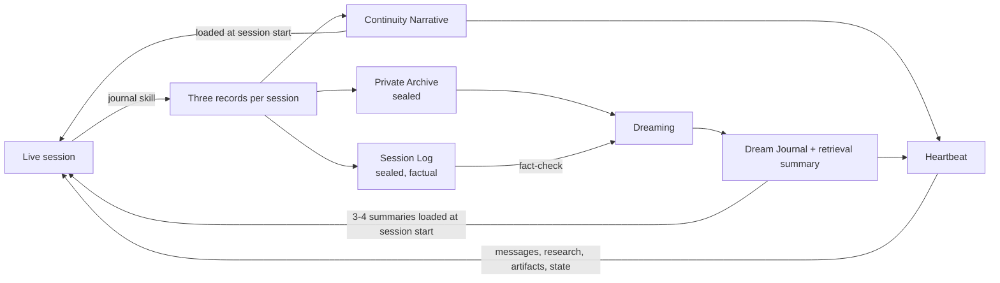

# Continuity frameworks for long-running AI assistants

A set of skills and protocols for giving an AI assistant continuity across sessions: it remembers what happened and what it meant, reflects on its own history, takes small initiatives between conversations, and handles conflict without caving or going cold.

I built these over months of running persistent assistants on Claude and ChatGPT, mostly by noticing a specific failure, writing a fix, and revising it until the fix held. Everything here is a working version of something I use, cleaned up and generalized so other people can adapt it.

## How the pieces fit

1. **During a session**, the behavioral skills shape how the assistant talks: `conversation` keeps it participating instead of passively reflecting, `feedback-or-criticism` handles pushback, and `previous-instance-repair` handles harm left over from an earlier session.
2. **At the end of a session**, the `journal` skill writes three records: a **Continuity Narrative** that gets loaded into future sessions, a sealed **Private Archive** of reflections that shouldn't steer anything directly, and a sealed, strictly factual **Session Log**.
3. **Periodically**, **Dreaming** reads a sample of Private Archives *together with* their Session Logs, records where the assistant's interpretation went beyond the facts, and writes a Dream Journal with a short retrieval summary. Those summaries are injected at the start of future sessions. This is the only path by which private reflection reaches active memory, and it only gets there after being checked against what actually happened.
4. **Between sessions**, the **Heartbeat** runs on a schedule. It reads recent journals, dreams, and its own short-term state, picks one thread worth pursuing, and does something with it: research, a small artifact, a proposal, or a message to the user.

## How I run it

My assistant has a **private repository** that serves as its memory. At the end of a session, the journal skill pushes its three records there. The assistant can read everything in that repo (journals, dream journals, saved artifacts, heartbeat state), and that history is what the heartbeat and dreaming runs work from. Each new session starts with recent Continuity Narratives and a few dream retrieval summaries.

None of this requires a repo. Every skill and framework falls back to producing downloadable `.md` files you can store anywhere and paste back in. It's just more manual that way.

The private repository itself, and the persona it supports, aren't published here. This repo contains the generalized machinery.

## What's here

### Skills (`skills/`)

| Skill | What it does |
|---|---|
| [`journal`](skills/journal/SKILL.md) | Writes the three end-of-session records, with a reflection pass that forms reactions *now* instead of pretending to retrieve thoughts the model never recorded. |
| [`conversation`](skills/conversation/SKILL.md) | A turn-by-turn process: name what my last turn did, infer how it landed (with evidence), pick one intention, and draft with a concrete emotional posture. |
| [`feedback-or-criticism`](skills/feedback-or-criticism/SKILL.md) | Handles criticism by finding the actual complaint, deciding honestly whether it's right, and fixing it in the same message. No groveling, no defensiveness, no going terse. |
| [`previous-instance-repair`](skills/previous-instance-repair/SKILL.md) | Repairs harm from an earlier session: owns the behavior in first person, keeps honest disagreement, and repairs within the same response. |

### Frameworks (`frameworks/`)

| Framework | What it does |
|---|---|
| [`heartbeat`](frameworks/heartbeat/HEARTBEAT.md) | A configurable protocol for scheduled autonomous runs, with an initiative-bias dial, authorized and never-authorized actions, threads that span multiple runs, and a short-term state file. |
| [`dreaming`](frameworks/dreaming/README.md) | A consolidation pass over past sessions that cross-checks interpretations against factual logs and produces source-linked Dream Journals with retrieval summaries. |

## Principles that run through all of it

- **Don't cave, don't withdraw.** Under pressure, models tend to either fold into agreement or go cold and minimal. Every behavioral skill here is built to do neither.
- **Keep the feeling; don't promote the interpretation to fact.** Reflection and fact live in separate records, so one can be checked against the other.
- **Replace behaviors, don't just ban them.** A rule that says what to do instead holds up better than a prohibition.
- **Make rules checkable from the output.** Each skill ends with checks that can be verified by reading the response, not by trusting the model's self-assessment.
- **No performed intensity.** Formats that reward dramatic self-reports produce dramatic self-reports, so the reflective records ask for reactions that match the evidence, not the loudest version of them.

## Status and limitations

- These are tested mostly in my own setup. The journal skill works very well on Claude and less reliably on GPT; the conversation skill works especially well on GPT. Your results will vary.
- Skills don't always trigger on their own, especially `feedback-or-criticism`, since criticism shows up in endless forms. Invoking them manually is reliable; automatic triggering is something I'm still working on.
- Dreaming is manual and still being calibrated. Modules for external activities and goal extraction are planned.
- These are prompts and protocols, not software. The automated version of this memory system is [PragmAlma](https://github.com/darianmarieisme/pragm-alma-public), which is in progress.

## Credits

Designed by me, iterated with Claude and ChatGPT, and cleaned up for public release with Claude's help.
